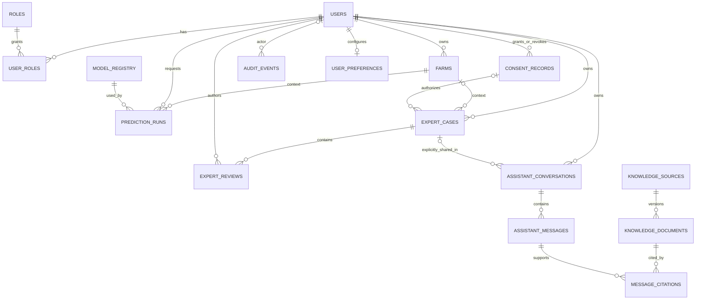

# BharatCrop Intelligence: Proposed Data Model

**Status:** Logical design only; not implemented. No migrations, SQL files, or deployed schema are created by this document. Table and field names are illustrative contracts, not existing repository objects.

## Design principles

- PostgreSQL is the proposed transactional store for application state, not a replacement for the existing notebook/data workspace.
- Every personal resource has a clear owner or purpose-bound access grant. Foreign keys and database constraints support, but do not replace, backend authorization.
- Keep identity-provider credentials/tokens out of this database. Store a stable provider subject reference only as needed to resolve an account.
- Keep model binaries, raw research datasets, and large source documents in controlled artifact/object storage when justified; PostgreSQL stores metadata, references, checksums, and access state.
- Persist units, source/evidence references, status, coverage, and timestamps with derived outputs. Do not encode unsupported confidence or model-version claims.
- Apply soft-deletion/tombstone state only where required for workflow or legal retention; physical deletion or anonymization must follow the approved retention schedule.

## Entity relationship diagram

Relationships and optionality are proposed. A production schema must define deletion behavior and row-level access strategy after implementation review.

## Proposed entities

### Essential MVP entities

| Entity | Proposed attributes and constraints | Relationships/indexes |
|---|---|---|
| `users` | `user_id` opaque primary key; `identity_issuer`; `identity_subject`; `display_name` nullable; `account_status`; `created_at`; `updated_at`; `deleted_at`/deletion state as policy requires. Unique `(identity_issuer, identity_subject)`. No password or provider token. | Unique identity subject; index active status if useful. |
| `roles` | Controlled `role_id` and unique `role_code` (`farmer`, `agricultural_expert`, `administrator`); description; status. | Stable controlled vocabulary. |
| `user_roles` | `user_id`, `role_id`, grantor/authority reference, status, `valid_from`, `valid_until`, timestamps. Unique active user-role grant as policy permits. | FK to users and roles; indexes by user/status and role/status. Expert/admin grants require approved verification/audit workflows. |
| `user_preferences` | `user_id` primary/FK; `language` constrained to supported locale; optional notification preference only after channel/purpose defined; `updated_at`, version. | One-to-one user. No inferred sensitive preference. |
| `farms` | `farm_id` opaque PK; `owner_user_id` FK; user label optional; verified `location_id` plus `location_reference_version` or explicitly governed location fields; area value/unit nullable only after unit contract; created/updated/deleted timestamps; version. Avoid precise coordinates unless necessity/consent approved. | Index `(owner_user_id, status/created_at)`; location index for authorized queries. Owner immutable through normal updates. |
| `consent_records` | `consent_id` PK; `grantor_user_id`; grantee/principal or grantee role; purpose code; exact resource/action scope; notice version; status; `granted_at`; `expires_at`; `revoked_at`; authorized-basis reference/type where non-consent basis is legally reviewed; revocation actor; minimal evidence metadata. | Index grantor/status/expiry and scope target. Never store unnecessary identity documents/free-text legal data. Enforce validity checks in transaction/service logic. |
| `model_registry` | `registry_id`; component type; task/target; artifact reference and checksum (nullable when no artifact); metadata/evidence references; recorded status; approval status kept separate; known restrictions; scope/coverage; effective dates; created/reviewed actor; immutable status-history reference. | Unique controlled registry identity; index status/task. A record does not imply artifact validity or release approval. |
| `prediction_runs` | `prediction_id`; requester/owner user ID; optional farm ID; task (`yield_estimate` or `yield_based_ranking`); minimal validated input snapshot or protected reference; result payload; units; status; coverage/evidence context; model registry FK nullable when unavailable; `requested_at`, `completed_at`; correlation/idempotency reference; retention/deletion state. | Index owner/time, farm/time, task/status. RLS/service scoping considered; never store broader input than needed. Do not persist unsupported future-risk warning outputs. |
| `expert_cases` | `case_id`; farmer owner FK; optional farm FK; case status; purpose; minimal case context; scoped consent/authorized-basis FK; assigned expert FK nullable; scope; opened/closed/expiry timestamps; version; deletion state. | Index owner/status, expert/status, expiry. Every read checks current grant; FK deletion strategy must not cascade away legally required audit evidence. |
| `expert_reviews` | `review_id`; case FK; author expert FK; review content/structured fields only after domain review; language; source references; status; created/updated timestamps; version. | Index `(case_id, created_at)`; authorship immutable. Sensitive content encrypted/restricted as appropriate. |
| `assistant_conversations` | `conversation_id`; owner user FK; language; optional explicit case FK; status; created/updated/last_activity timestamps; retention/deletion state. | Index owner/activity. Expert visibility only if conversation is expressly within an active grant. |
| `assistant_messages` | `message_id`; conversation FK; role; content; language; answer status; policy/abstention code; created_at; minimal provider/model operational reference only after provider selected; retention/deletion state. | Index conversation/time. Sensitive content access restricted. Do not store credentials or hidden chain-of-thought. |
| `knowledge_sources` | `source_id`; title/publisher; canonical origin/reference; source language; ownership/provenance; terms/license review status/reference; review status; created/updated actor and timestamps. | Index publication/review status. Submitted origin is not fetched arbitrarily. |
| `knowledge_documents` | `document_id`; source FK; immutable version identifier; title; language; content/artifact reference; checksum; effective/publication dates; review state; ingestion state; access/retention classification; created/reviewed actors and timestamps. Unique `(source_id, version)`. | Index source/version/status/effective dates; retrieval index external or managed separately, tied to immutable document version. |
| `message_citations` | `citation_id`; assistant message FK; knowledge document/version FK; retrieved passage reference; display title/source attribution; ordering; validation status. | Index message and document/version. Every user-visible citation resolves to a reviewed version. |
| `audit_events` | `event_id`; timestamp; actor user ID nullable for system; action; resource type/opaque ID; purpose/reason code; outcome; request/correlation ID; minimal metadata; retention classification. No secret or full payload fields. | Index time, actor/time, resource/time, action/time. Append-only privileges and tamper-evidence strategy to be designed. |

### Optional/deferred entities

| Entity | Reason deferred / conditions |
|---|---|
| `locations` and versioned boundary hierarchy | Requires authoritative source, stable identifiers, boundary vintage, terms, and coverage verification. Do not finalize a district schema from the repository's provisional crosswalk. |
| `weather_observations` / external-data cache | Add only after source, units, temporal resolution, licensing, refresh, and coverage are approved. Current files include exploratory mapping. |
| `notification_deliveries` | Requires approved channels, opt-in and delivery provider, templates, retry/retention rules. |
| `expert_verifications` and `case_assignments` history | Detailed expert qualification/assignment process remains unresolved; role grants and audit may be sufficient for the first iteration, but history must be captured if policy requires. |
| `model_evaluation_runs` | Useful for formal governance once reproducible evaluation pipeline/ownership exists; current reports are static notebook outputs and not independently reproduced. |
| `assistant_feedback` and evaluation datasets | Add only with privacy-safe consent and retention policy; do not reuse personal conversations for training without separate approved basis. |

## Sensitive-field handling

- Identity subject and contact details are personal data; separate identity-provider management from application records and store only fields required by the product.
- Farm location, crop, and area can be sensitive; restrict precision, access and logs. Determine whether exact coordinates are necessary before collection.
- Consent records are evidence of authorization; protect against unauthorized modification and preserve purpose/scope/timestamps.
- Case/review and assistant text may include personal or high-sensitivity information. Encrypt/restrict access, avoid content in logs/metrics, set retention, and support deletion/withdrawal semantics.
- Model inputs/results may reveal farm attributes. Store only if saved history is needed; make persistence explicit and subject to owner deletion/retention policy.
- Secrets, access tokens, passwords, credentials, and raw provider payloads do not belong in business tables or audit event metadata.

## Ownership, deletion, and retention

- A farmer owns their user profile, farms, saved results, preferences, and conversations. Expert access does not transfer ownership.
- `owner_user_id` must be immutable through self-service updates. Backend queries always scope by principal and, for experts, an active case authorization.
- Deletion requests must cover derived references and downstream copies, not just the user row. Define transactional tombstone, anonymization, physical deletion, backups, legal holds, and downstream provider deletion before launch.
- Revoking consent blocks future expert access and future processing under that consent. It does not automatically erase records whose retention is required under a separately reviewed basis; communicate this transparently.
- No retention periods are established here. Legal/privacy review must define periods per data class, deletion completion targets, backup expiry, and audit-log retention.
- `ON DELETE CASCADE` must not be applied broadly without reviewing audit, legal, ownership, and shared-case implications.

## Consistency and indexing

Use database uniqueness/check constraints for immutable identity mapping, controlled role/status/language values, positive revisions, and idempotency uniqueness. Use transactions for consent grants/revocation, case access checks/state changes, and result persistence. Authorization must be rechecked at transaction boundaries for sensitive operations. Index foreign keys and common owner/status/time filters; add retrieval/vector indexes only after the knowledge implementation is chosen and evaluated. Exact partitioning, encryption, row-level security, and backup topology are implementation decisions.

## Existing versus proposed

No PostgreSQL schema, migrations, or application data model was found in the repository audit. Every entity, key, field, relationship, index, and lifecycle rule above is proposed. Existing CSV/JSON metadata and notebook artifacts are not database tables and must remain preserved.
