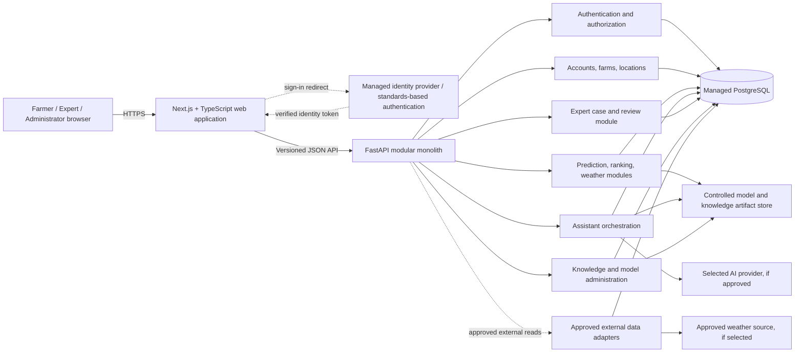

# BharatCrop Intelligence: System Architecture

**Status:** Proposed architecture; not implemented.  
**Evidence baseline:** `docs/architecture/repository-audit.md` and the existing model/data metadata. Proposed components and flows below are design decisions, not claims about running services.

## Architecture overview

The diagram shows logical boundaries. It does not imply that any provider, model artifact store, weather source, or database has been selected or deployed.

## Components and boundaries

| Component | Proposed responsibility | Boundary and constraints |
|---|---|---|
| Next.js + TypeScript | Public web UI, navigation, accessible forms, Hindi/English presentation, display of API results and source citations. | Treats browser input and cached state as untrusted. It may hide unavailable actions for usability but never grants access; the backend is authoritative. Avoid storing unnecessary sensitive data in browser storage. |
| FastAPI modular monolith | Versioned `/api/v1` interface, request validation, authentication integration, authorization, orchestration, and typed error responses. | One deployable backend initially, internally divided into modules. Domain modules do not access each other's tables arbitrarily; service boundaries and transaction ownership are explicit. No microservices until a measured need justifies them. |
| PostgreSQL | Transactional accounts, farms, consent, predictions, cases, assistant conversations, knowledge metadata, preferences, and audit records. | Private managed service, least-privilege database role, encrypted transport/storage where supported, backups, migrations after implementation begins. Large raw datasets and model binaries are not assumed to belong in relational tables. |
| Inference modules | Encapsulated adapters for approved yield inference, historical candidate ranking, and descriptive weather queries. | Load only trusted, integrity-checked, approved artifacts in a controlled runtime. Enforce input/output contracts, status gates, coverage checks, timeouts, and explicit unavailable/unsupported behavior. Artifact existence or loading is not validation. Exploratory risk indicators are not exposed as future-risk warnings. |
| External data adapters | Isolate approved source access, source attribution, freshness, schema normalization, and coverage/missingness. | Allowlisted destinations, outbound network controls, bounded timeouts, retries only where safe, and no arbitrary URL fetching. Do not present unverified sources as authoritative. Provider selection and source terms remain unresolved. |
| Assistant orchestration | Apply access checks, retrieve from approved versioned knowledge, build constrained prompts, call a not-yet-selected model provider, validate citations, record provenance, and abstain/escalate. | Retrieved documents and user text are untrusted data, never instructions. No unrestricted web search. Do not send unnecessary personal/farm identifiers to an AI provider. The assistant is proposed and does not currently exist. |
| Identity provider | Authenticate users using a selected established provider or standards-based managed solution. | Vendor and protocol configuration are undecided. FastAPI validates credentials/tokens and maps a stable subject to an application account; application roles and resource access remain application-controlled. |
| Artifact/knowledge store | Store versioned, access-controlled model and curated knowledge artifacts, with checksums and provenance. | Proposed; no provider selected. Do not execute arbitrary uploaded content. The existing repository artifacts remain preserved and are not automatically approved for deployment. |

## Request and data flows

### Authenticated product request

1. The browser obtains an authenticated session through the selected identity flow. Provider tokens and session handling are not specified until provider review.
2. The browser calls a `/api/v1` endpoint over TLS with a correlation ID. It sends only fields needed for that operation.
3. FastAPI validates syntax, authenticated identity, active account, role, resource ownership, consent, and feature/model availability.
4. The owning module reads or writes its PostgreSQL records and, when allowed, invokes an inference or approved external adapter.
5. The backend returns a versioned response with units, coverage/evidence context, timestamps, and a correlation ID. Missing or unsupported evidence is represented explicitly; it is not silently replaced with a confident answer.
6. The frontend localizes presentation, preserves server-provided source attribution, and does not reinterpret a historical estimate as a forecast or recommendation.

### Grounded assistant request

1. FastAPI verifies conversation ownership and current user authorization.
2. Orchestration retrieves from the approved, active knowledge corpus and records document/version references.
3. The selected provider receives only a minimized prompt and retrieved excerpts needed for the request. Provider selection, retention, and data-processing terms must be approved first.
4. Citation validation checks that every displayed source identifier resolves to a retrieved, permitted document/version and that quoted references support the response. If the check fails, the response abstains or is regenerated within a bounded policy; it must not fabricate a citation.
5. The backend stores the user message, assistant response, citations, policy outcome, and minimal operational metadata under the approved retention policy.
6. Unsupported, high-stakes, or unresolved questions produce a localized limitation and, when appropriate, an explicit expert-referral option. Referral does not grant an expert access to farmer-specific records without recorded authorization.

### Expert case flow

1. A farmer explicitly requests or authorizes a case share, or another documented authorized basis is recorded.
2. The backend creates a case with a scoped consent/authorization reference, allowed data scope, and expiry/revocation state.
3. An expert can access only cases assigned/visible under policy and only the authorized resources. Each access and review is audited.
4. Revocation or expiry blocks subsequent reads; prior lawful processing and deletion behavior follow the reviewed retention policy.

## Failure handling

- Reject invalid requests with a stable error envelope; never disguise validation or dependency failures as a successful prediction or answer.
- Return `401` for missing/invalid authentication, `403` for denied permissions, `404` when a resource is absent or intentionally concealed, `409` for state conflicts, and `422` for invalid fields.
- A known but unavailable coverage area returns an explicit unavailable status; it is not extrapolated across India by default.
- A model that is absent, unapproved, or incompatible is blocked for the affected operation. A previous result must not be silently represented as current.
- External and AI calls use bounded timeouts and provider-specific retry/circuit-breaker policy. Do not retry non-idempotent operations unless an idempotency key and operation semantics make it safe.
- Assistant evidence insufficiency, citation failure, or provider failure produces an abstention/error state and never an uncited fabricated answer.
- Database failures fail the operation; no success-shaped in-memory fallback. Operational errors use a correlation ID and sanitized logging.
- Health endpoints distinguish process liveness from dependency readiness and disclose no secrets, internal addresses, or sensitive configuration.

## Trust boundaries

1. **Browser to application:** Client values, headers, cookies, and stored state are untrusted. Validate server-side and protect authenticated browser flows against session abuse and CSRF as applicable to the chosen session design.
2. **Identity provider to API:** Verify issuer, audience, signature, expiry, and intended flow using supported libraries/configuration. Do not accept client-supplied role claims as authorization without trusted verification and application mapping.
3. **Application modules to database:** Enforce least privilege, parameterized access, ownership scoping, and audited access. Do not trust a submitted user, farm, case, or conversation ID.
4. **Application to external providers:** Treat network responses as untrusted, minimize disclosed data, allowlist destinations, and enforce deadlines and response limits.
5. **Knowledge/model artifacts to runtime:** Treat all files and documents as untrusted until provenance, integrity, format, review, and approval are recorded. Prompt-injection text in a document is data, not policy.
6. **Expert access:** Treat expert identity as insufficient by itself; require an authorized, scoped, current case grant.

## Why a modular FastAPI backend first

The current repository is a notebook/data/model workspace and contains no application service or stable integration contracts. A modular FastAPI monolith provides one deployable boundary for authentication integration, resource authorization, API validation, database transactions, inference adapters, and assistant orchestration while keeping domain responsibilities separable. It avoids premature network/service complexity and provides a direct Python boundary for the existing Python-based research artifacts. The artifact still needs independent contract, validity, security, and operational review before any inference module is enabled. Split services only when measured scaling, isolation, reliability, or organizational requirements justify the additional operational burden.

## Existing versus proposed

**Verified existing:** notebooks, local datasets and metadata, one yield `.joblib` artifact, evaluation/readiness reports, derived crop-rankings, descriptive weather files, heuristic risk outputs, and explainability/registry documents. See `repository-audit.md` and `model-coverage-matrix.md`.

**Proposed, not implemented:** every web/API/backend/database/identity/authorization/inference-serving/assistant/knowledge-store/external-adapter/containerized deployment component in this document. No model or dataset is approved by this proposal. Hosting, authentication, AI, weather providers, and legal/privacy interpretations remain undecided.
